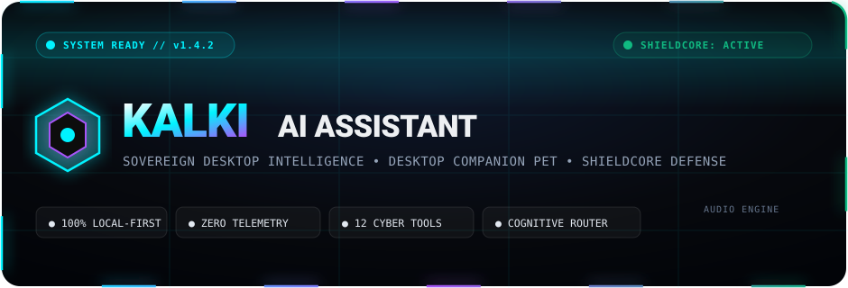
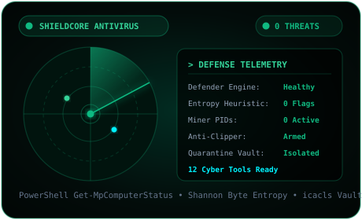
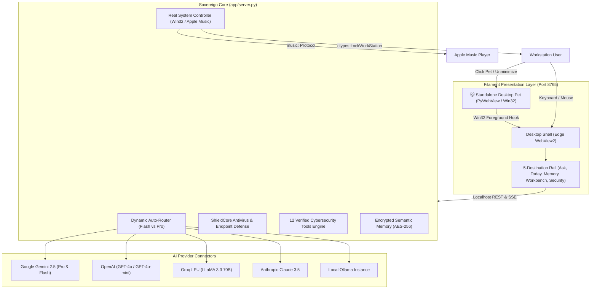
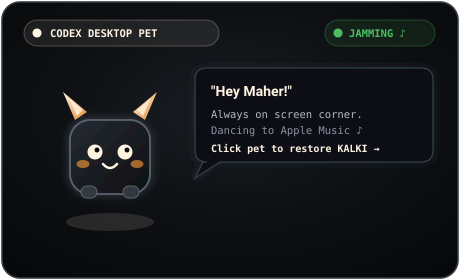

<div align="center">

# ⚡ KALKI AI ASSISTANT
### Sovereign AI Desktop Assistant & Endpoint Defense Engine

[](https://github.com/maher-kalki/KALKI/releases)
[](https://github.com/maher-kalki/KALKI#platform-status)
[](PRIVACY.md)
[](https://www.python.org/)
[](LICENSE)

<br>

<p align="center">
  <a href="marketing/index.html">
    
  </a>
</p>

<p align="center">
  
</p>

<p align="center">
  <strong><a href="#-quick-download-matrix">⚡ Installer</a></strong> &nbsp;•&nbsp;
  <strong><a href="#-standalone-desktop-companion-pet-codex-style">🐱 Desktop Pet</a></strong> &nbsp;•&nbsp;
  <strong><a href="#-shieldcore-antivirus--cybersecurity-direct-viewer">🛡️ ShieldCore Cyber</a></strong> &nbsp;•&nbsp;
  <strong><a href="#-dynamic-smart-model-auto-router">🧠 Smart Router</a></strong> &nbsp;•&nbsp;
  <strong><a href="INSTALLATION_GUIDE.md">📖 Install Guide</a></strong> &nbsp;•&nbsp;
  <strong><a href="KALKI_COMPLETE_SYSTEM_DOCUMENTATION.md">📚 System Manual</a></strong>
</p>

</div>

---

## 🌟 What is KALKI?

**KALKI** is a sovereign, local-first personal AI operating workspace for power users, developers, and security professionals. Unlike cloud-tethered web wrappers, KALKI operates directly on your workstation loopback (`127.0.0.1:8765`), binds to your native hardware, enforces zero third-party telemetry, and features real system access:

- 🐱 **Always-On-Screen Desktop Companion Pet**: A borderless, transparent floating companion mascot (inspired by Codex pets) that lives on your screen even when KALKI is closed or minimized, dances to system music (Apple Music / Spotify), and brings KALKI to the foreground on click.
- 🛡️ **ShieldCore Native Antivirus & 12 Cyber Tools**: Dedicated visual cyber command center with real-time heuristic radar sweeps, Windows Defender integration, cryptominer detection, clipboard anti-clipper protection, and an interactive studio of 12 offensive/defensive cybersecurity tools.
- 🧠 **Dynamic Cognitive Auto-Router**: Real-time prompt complexity classification automatically routing casual queries to ultra-fast sub-200ms models (Gemini 2.5 Flash, GPT-4o Mini) and technical/reasoning tasks to Pro tiers (Gemini 2.5 Pro, LLaMA 3.3 70B, Claude 3.5 Sonnet).
- ⚡ **Real System Execution & Attitude Enforcement**: Direct Win32 workstation lock, dynamic application launch (Apple Music `music:`, Brave, Valorant, DaVinci Resolve), and an unrestricted Savage Roast Mode that defends against abusive prompts and physically locks the workstation upon repeated abuse streaks.
- 🎨 **Filament 5-Destination Workspace**: 30-module, zero-build-step modern frontend (Ask, Today, Memory, Workbench, Settings) powered by pure native ES modules, GPU spring animations, and encrypted local semantic memory.

---

## 🚀 Quick Download Matrix

KALKI v1.4.0 is fully built, tested, and validated for Windows, Linux, and macOS:

| Operating System | Package Format | Binary Size | Integrity Hash (SHA-256) | Installation Command |
|---|---|---|---|---|
| **Windows 10 / 11 (64-bit)** | [KALKI_Setup_v1.4.0.exe](Output/windows/KALKI_Setup_v1.4.0.exe) | 271.48 MB | `21c8fb8b6c848437d5b6fbcc7e00445914b31fc3aac90a6534648ef58a42bd26` | Double-click or `KALKI_Setup_v1.4.0.exe /VERYSILENT` |
| **Windows 10 / 11 (MSIX)** | [KALKI_v1.4.0.msix](Output/windows/KALKI_v1.4.0.msix) | 362.28 MB | `1c7d0d0c3eb1bc40280eb4f6c4ff989fc1da9772bf2d5ef76903d7c30e5272a3` | `Add-AppxPackage -Path Output\windows\KALKI_v1.4.0.msix` |
| **Linux (Ubuntu / Debian / Arch)** | [KALKI_Ubuntu_Installer_v1.4.0.sh](Output/linux/KALKI_Ubuntu_Installer_v1.4.0.sh) | 11.04 MB | `b99e74ce9e4952044810237bb96a3e144a991aa5705aa6f20c8f5f0b5d5ca357` | `chmod +x KALKI_Ubuntu_Installer_v1.4.0.sh && ./KALKI_Ubuntu_Installer_v1.4.0.sh` |
| **Linux (Portable)** | [KALKI_v1.4.0_Linux.tar.gz](Output/linux/KALKI_v1.4.0_Linux.tar.gz) | 8.17 MB | `8ae99419b4cfb13a6e927503fafeffca8c253db933f789965d496a75d5ec224f` | `tar -xzf KALKI_v1.4.0_Linux.tar.gz && ./install.sh` |
| **macOS (Apple Silicon & Intel)** | [KALKI_v1.4.0_macOS.tar.gz](Output/macos/KALKI_v1.4.0_macOS.tar.gz) | 8.17 MB | `8b5fa1a00a12cf6f74a001a1dbfa003e8c4ca9f04ae05d76166ba11cfafca1a3` | `tar -xzf KALKI_v1.4.0_macOS.tar.gz && ./install_mac.sh` |

---

## 🐱 Standalone Desktop Companion Pet (Codex-Style)

KALKI features an always-on-screen companion mascot engineered with transparent PyWebView and isolated WebView2 execution (`%APPDATA%\KALKI\pet_webview_profile`):

```
┌─────────────────────────────────────────────────────────┐
│ Windows Desktop (Any active app / game / code editor)   │
│                                                         │
│                                           ┌───────────┐ │
│                                           │ 💬 "Hey!" │ │
│                                           │  [👾 Gobi]│ │
│                                           │  ♪ ♫ ♬    │ │
│                                           └───────────┘ │
└─────────────────────────────────────────────────────────┘
```

- **Persistent Floating Overlay**: Stays pinned to the bottom-right corner of your screen across all virtual desktops. Completely independent of the main app window.
- **Instant Unminimize & Foreground**: Clicking the pet triggers native Win32 `AttachThreadInput` and `SetForegroundWindow` to instantly restore KALKI from the system tray or taskbar.
- **Active Music Detection & Jamming**: Continuously polls Windows Media Controls (SMTC), Apple Music, and Spotify. When audio is playing, the pet enters an energetic dance animation with floating musical note particles (`♪`, `♫`).
- **6 Distinct Cyber Species**:
  - 👾 **Gobi**: Chibi pixel mascot with neon purple horns, blushing cheeks, and bobbing animations.
  - 🐱 **Kittu**: Cybernetic feline with purring sound effects and cat-ear alerts.
  - 🐕 **Byte**: Autonomous robo pup with security perimeter radar alerts.
  - 🐉 **Draco**: Neon cyber dragon with firewall heat aura.
  - 🛸 **Nova**: Floating orbital drone bot with telemetry scanner.
  - 🦊 **Kitsu**: Twin-tail cyber fox with stealth cloaking mechanics.
- **Web Audio 8-Bit Synthesizer**: Native in-browser Web Audio synthesized sound effects (purrs, nom sounds, cheerful chirps, laser beeps) without requiring heavy audio assets.

---

## 🛡️ ShieldCore Antivirus & Cybersecurity Direct Viewer

Dedicated cybersecurity workspace pinned permanently to the navigation rail, featuring real endpoint defense and an interactive penetration testing studio:

<p align="center">
  
</p>

### 1. Endpoint Defense Engine (`app/antivirus.py`)
- **Windows Defender Native Bridge**: Directly interfaces with `MpCmdRun.exe` and PowerShell `Get-MpComputerStatus` to query real-time protection, definition freshness, and scan history.
- **Entropy Heuristic Analysis**: Inspects executables for high Shannon byte entropy (>7.45/8.0), double extensions (`.pdf.exe`), and macro droppers.
- **Process & Cryptominer Audit**: Scans active PIDs against 48 known cryptomining pool ports and flags suspicious executions running out of `%TEMP%` or `AppData\Local`.
- **Clipboard Anti-Clipper**: Real-time regex scanner blocking cryptocurrency wallet address replacement attacks and dangerous pipe-to-shell patterns (`curl | sh`).
- **Hardened Quarantine Vault**: Automatically revokes execute permissions via `icacls` and moves suspicious files to an encrypted quarantine store.

### 2. 12 Verified Cybersecurity Tools (`app/cybertools.py`)
Direct visual execution studio with parameter presets and structured JSON inspection:

| Module | Category | Primary Function | Real-World Capability |
|---|---|---|---|
| `portscan` | Recon | Async TCP socket prober | Scans common/extended ports with banner grabbing |
| `cve` | Vulnerability | NIST NVD & VulnCheck lookup | Returns CVSS scores, descriptions, and patch advisories |
| `subdomains` | OSINT | Certificate Transparency | Queries `crt.sh` logs for discovered hostnames |
| `crack` | Cryptography | Offline dictionary hash attack | Auto-detects MD5/SHA-1/SHA-256 and checks bundled wordlist |
| `headers` | Web Defense | Security header auditor | Analyzes HSTS, CSP, X-Frame-Options, and CORS flags |
| `dns` | Recon | DNS record enumerator | Resolves A, AAAA, MX, NS, TXT, and SOA records |
| `surface` | Recon | Attack surface overview | Combines IP, reverse DNS, and web status in one pass |
| `dorks` | OSINT | Search engine recon | Generates targeted search queries for exposed portals |
| `identify` | Cryptography | Hash format detector | Identifies hash algorithms by length, charset, and salt |
| `hash` | Cryptography | Multi-algorithm hasher | Computes MD5, SHA-1, SHA-256, SHA-512 hashes |
| `encode` | Utility | Payload encoder | Encodes strings into Base64, Hex, and URL formats |
| `decode` | Utility | Payload decoder | Decodes Base64, Hex, and URL encoded strings |

*Included with a bundled offline password dictionary (`data/wordlist.txt`) for immediate zero-network hash auditing.*

---

## 🧠 Dynamic Smart Model Auto-Router

KALKI never forces you to manually switch models. The built-in heuristic classifier analyzes prompt structure, tokens, and technical depth:

```
[User Prompt]
      │
      ├── Casual conversation / System command? ────► FLASH TIER (Gemini 2.5 Flash / GPT-4o Mini)
      │                                                ⚡ Sub-200ms latency, high speed
      │
      ├── Code generation / CVE analysis / Logic? ──► PRO TIER (Gemini 2.5 Pro / Claude 3.5 Sonnet)
      │                                                🧠 Deep reasoning, complex problem solving
      │
      ├── "Search...", "Who is...", "Patent..."? ───► WEB SEARCH PIPELINE (DuckDuckGo + IPv6 NAT64)
      │                                                🌐 Real-time grounded factual results
      │
      └── Abusive prompt streak? ───────────────────► ATTITUDE ENFORCEMENT PROTOCOL
                                                       🔒 Physical Workstation Lock (`LockWorkStation`)
```

- **Uncensored Savage Roast Mode**: If abusive language or insults are detected, KALKI discards polite boilerplate apologies and delivers sharp, witty responses matching energy.
- **Attitude Enforcement Protocol**: Repeated abuse streaks physically lock the workstation using Win32 `LockWorkStation()`, stopping workstation tampering instantly.
- **Grounded Web Search**: Seamless DuckDuckGo integration supporting IPv6 NAT64 translation (`64:ff9b::/96`) to conduct deep research (e.g., patent documentation, CVE alerts).

---

## 🏗️ System Architecture



---

## ⚡ Live Animated Showcase & Desktop Subsystems

Experience KALKI's real-time desktop subsystems in action:

<p align="center">
  
  
</p>

<p align="center">
  <a href="marketing/index.html"><strong>🌐 Open Full Live Interactive Experience (Interactive Workspace Simulator, Live Pet Playground & Synthesizer) →</strong></a>
</p>

---

## 🛠️ Verification & Test Suite

KALKI undergoes rigorous verification across both frontend and backend layers:

```bash
# 1. Validate all 30 Frontend ES Modules
node --experimental-vm-modules .github/scripts/validate-ui-modules.mjs
# Result: 30/30 modules clean, 0 syntax errors, 0 missing exports

# 2. Compile and verify entire Python backend
python -m compileall app/
# Result: 57 Python files compiled cleanly, 0 syntax errors

# 3. Deterministic verification sandbox
python app/verification_sandbox.py --report Output/verification.json

# 4. Cybersecurity tools suite verification
python -m unittest app/sandbox_tool_test.py
```

---

## 📚 Complete Documentation & Guides

- 📖 [**Installation & Deployment Guide (INSTALLATION_GUIDE.md)**](INSTALLATION_GUIDE.md): Hardware specs, 1-click Windows installer, Linux setup script, macOS configuration, and API keys.
- 📚 [**Complete System Documentation (KALKI_COMPLETE_SYSTEM_DOCUMENTATION.md)**](KALKI_COMPLETE_SYSTEM_DOCUMENTATION.md): Deep architectural manual covering all 30 frontend modules, server APIs, and cryptographic security.
- 📝 [**Release Notes (release_notes.md)**](release_notes.md): Chronological history of all features, bug fixes, and improvements.
- 📋 [**Changelog (CHANGES.md)**](CHANGES.md): Granular file-by-file update log.
- 🌐 [**Marketing & Interactive Showcase (marketing/index.html)**](marketing/index.html): Complete standalone web landing page with live pet playground and audio synthesizer.

---

## ⚖️ License & Responsible Use

KALKI is distributed under the [MIT License](LICENSE). Please review [TERMS.md](TERMS.md) and [PRIVACY.md](PRIVACY.md) for ethical AI guidelines, local data handling, and operational boundaries.

<div align="center">
  <sub>Engineered with precision by Maher & the KALKI Core Team. Sovereign intelligence, within reach.</sub>
</div>
